  
  
  

I'm a Computer Science & Engineering student at UMaT and a full-stack developer in Ghana. I build web and mobile products end to end: the interface, the API, the database and the deploy.

Lately that means an Android app that reads Mobile Money texts, a hostel finder for students, and video chat over WebRTC. I care about products that feel as good to use as they were to build.

## Now building

## Shipped

| Project | What it does | Built with |
|---|---|---|
| **[Uni-Cam](https://uni-cam.vercel.app)** | Random video chat for university students | Next.js, WebRTC, Socket.IO |
| **[Miuzicly](https://miuzicly.vercel.app)** | Music streaming and discovery with real-time playback | Next.js, TypeScript, Node.js |
| **[Rabi Reigns](https://rabireigns.vercel.app)** | Website for a Ghanaian Afrobeats artist | Next.js, Tailwind, GSAP |
| **[SL](https://sl-gh.com)** | Corporate platform for a production company | React, Vite, Tailwind, Framer Motion |
| **[Portfolio](https://danielstrevor.vercel.app)** | My interactive developer portfolio | Next.js, TypeScript, Tailwind |
| **FaceGuard** | Desktop app that monitors a camera with face recognition | Python, OpenCV, dlib, SQLite |

## Tools I reach for

   
  

Mobile apps with React Native and Expo. Real-time features with WebRTC and Socket.IO. Motion with GSAP and Framer Motion.

## On GitHub

  
  

  

<picture>
  <source media="(prefers-color-scheme: dark)" srcset="https://raw.githubusercontent.com/Trevor-030/Trevor-030/output/snake-kente-dark.svg" />
  
</picture>

